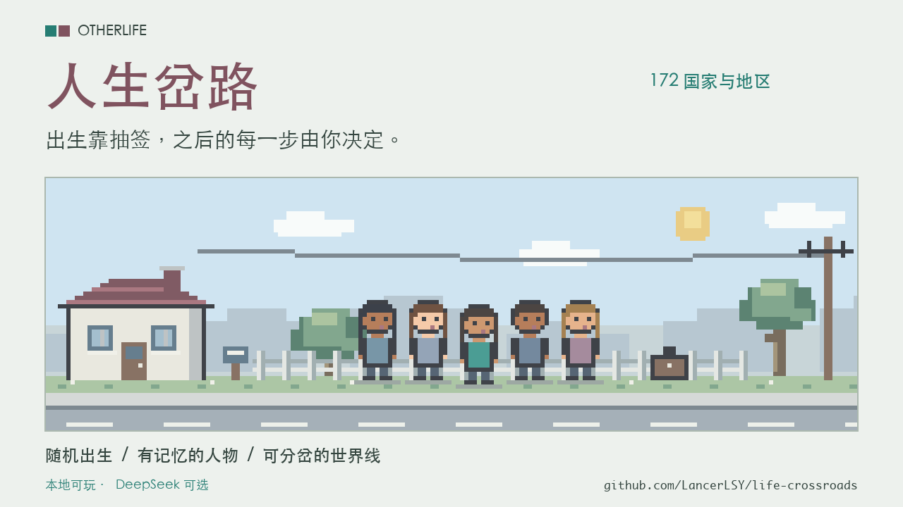
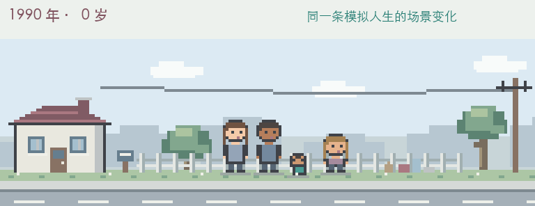
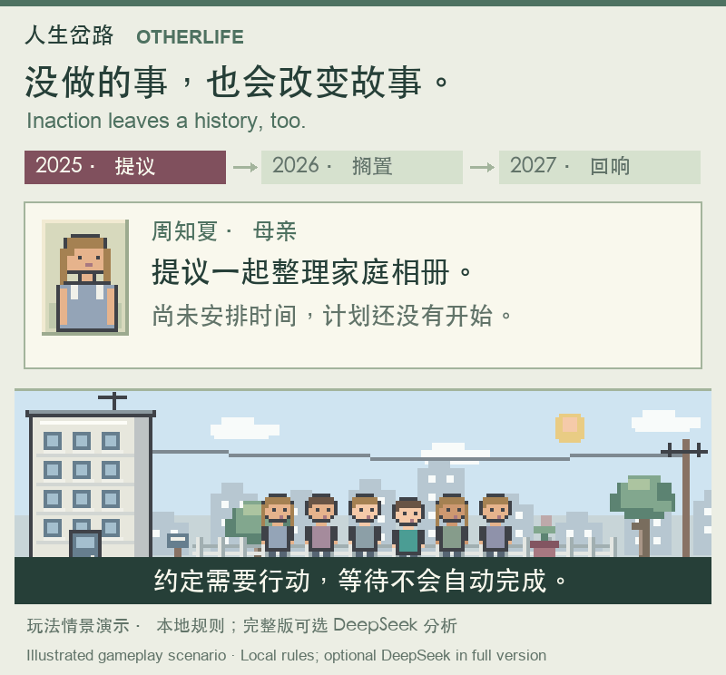

# 人生岔路 · Otherlife

[立即试玩](https://lancerlsy.github.io/life-crossroads/) · [English](README.en.md) · [版本发布](https://github.com/LancerLSY/life-crossroads/releases) · [反馈与建议](https://github.com/LancerLSY/life-crossroads/issues) · [MIT许可](LICENSE)

[](https://github.com/LancerLSY/life-crossroads/actions/workflows/ci.yml)



**出生靠抽签，之后的每一步由你决定。**

一个从随机出生开始的像素风人生模拟游戏。选择过去、当下或未来的世界，在连续流动的时间里学习、工作、经营关系。花过的钱、去过的地方、说过的话和做过的承诺，都可能成为后来故事的起点。

- **172个国家与地区的随机出生**：抽取出生地、身份和家庭，逐项揭晓你的人生起点。
- **有记忆的人物关系**：关心、陪伴、帮助和失约会留下后果；承诺需要实际行动兑现。
- **会继续发展的世界线**：关系、消费、旅行与迁居影响线索走向；可以回到旧选择前，保留原来的未来，再走一条路。
- **像素画面随人生变化**：从襁褓到晚年，家人、住宅、工作与结局都会改变场景。
- **本地可玩，DeepSeek可选**：无需模型密钥即可开始；接通自己的API后，NPC对话和事件叙事会更加丰富。



**[点开就玩，无需安装 →](https://lancerlsy.github.io/life-crossroads/)** 在线试玩使用本地故事引擎，进度保存在当前浏览器。想接入自己的DeepSeek，可按下方步骤运行完整版本。欢迎Star，或在Issues分享你经历的故事。

<details>
<summary>看一个具体例子：没做的事，也会改变故事</summary>



这是一次真实模型调用支持的虚构人物情景演示，展示本地结算规则与完整版可选的DeepSeek分析；在线试玩本身使用本地故事。

</details>

程序、叙事、名称和美术为独立实现。基础功能对照见 [功能核对表](docs/parity.md)，本次实际使用官方 **REA 6.7.0** 分析发布程序的像素与时钟流程，证据见 [REA 重建说明](docs/rea-reconstruction.md)。

## 开始运行

需要 Node.js **22.18 或更新版本**。

```sh
git clone https://github.com/LancerLSY/life-crossroads.git
cd life-crossroads
npm ci
npm run dev
```

打开 http://127.0.0.1:5173 。前端与 API 服务会一起启动，API 在 3001 端口。没有模型密钥时，完整本地模拟仍可游玩。

## 接通 DeepSeek

复制 `.env.example` 为 `.env.local`，在本地填写：

```dotenv
DEEPSEEK_API_KEY=你的真实密钥
DEEPSEEK_BASE_URL=https://api.deepseek.com
DEEPSEEK_MODEL=deepseek-flash
```

重启服务，在游戏设置中刷新连接状态。模型名可按账户可用模型修改。接口使用 DeepSeek Chat Completions 的 JSON 输出；模型负责事件叙事、人物对话和有事实依据的年度关系评估，年龄、资产、教育、关键决定及最终数值仍由模拟规则控制。

密钥仅在服务端读取。**不要使用 `VITE_` 前缀，不要提交真实 `.env` 文件。** 可配置 `GAME_ACCESS_TOKEN` 限制共享站点的模型访问；访问口令只在当前浏览器页面会话中使用。

“世界智能”调节叙事丰富程度、NPC 主动发言，以及持续世界线索的出现、延续和交织。0 为本地模式；快转时优先在抉择处请求模型，80 以上也生成途中故事。对话与年度叙事保留人物性格、关系、共同记忆、当前线索和近期世界事件。学习、医疗、社交、旅行、购房、还款、投资及迁居会留下不同的后续；旅行、社交和迁居还能结识当地人物。线索会跨年发展，支持、疏远、冲突和你的选择影响其走向。请求失败时会显示提示并使用本地故事。

## 玩法

- 新出生流程：选择年代和节奏 → 抽取人生 → 逐项揭晓出生地、身份和家庭 → 出生登记。抽签结果在动画前固定并保存，跳过动画和刷新不会重新抽取。像素世界背景与实体纸签控件构成新的抽签界面。
- 原生 **192×60** 动态像素生活场景与 **24×32** 人物肖像；年龄、家庭成员、居住环境、房屋、职业及明暗主题会改变画面。点击场景中的家人即可开始对话。

- 在 172 个国家与地区中，按出生人数或总人口权重抽取出生地；出生身份通过抽签决定，不能指定出生地或名字。每一生从 0 岁开始，有独立随机种子、性别、家庭条件和父母。
- 过去的世界随历史数据演变；当下冻结基准条件；未来使用明确标注的游戏情景。自由选择出生年份是本作额外功能。
- 30 / 60 / 90 分钟控制一生的播放节奏；支持暂停、1 / 2 / 4 / 8 / 12 / 16 倍速、快转至下个抉择和自动抉择。重要选择与阶段手记会阻止时间继续。
- 点击选项或按数字键即可直接决定，不再需要确认按钮。选择发生在当年，不会直接增加年龄。年度重心从 6 岁起开放，按当年投入时间加权结算。
- 教育、工作、晋升、退休、伴侣、育儿、医疗和迁居影响后续机会与收支。家庭账本支持消费、房产、贷款和七种投资政策，投资可能亏损。
- 四位同年出生的人使用相同模拟规则独立经历一生。人生格子记录每年状态，存活曲线展示模拟模型的群体风险。
- 世界线索记录参与人物、起因、发展阶段、关系影响和下一节点，并随时间分支保存。新事件优先衔接已做过的行动；AI不会替换入学、家庭和线索节点的硬性选择。
- [连续因果](docs/causal-world.md)：计划需要不同年份的实际投入才能完成；等待、搁置、主动结束与完成分别记录。收支、职业、健康和照护责任进入当前情境，因果经过可展开回看。模型也会主动分析长期冷落等事实，人物关系可以变坏；同一依据不能重复刷分或扣分。
- NPC 有信任、亲密、性格、心情、对话和记忆。说话的含义、倾听、陪伴、帮助、道歉和失约会改变关系；承诺需要实际行动兑现，同年重复互动不会反复加分。关系变化有原因和历史，未修复的伤害会影响后续世界线索。新相遇按当地命名，迁居保留旧朋友姓名；成年伴侣关系需要明确选择，离世人物保留记忆。
- 成年后可选择海外旅行目的地。新增[缅甸虚构隐藏支线](docs/fictional-surprise.md)：到访时80%触发，触发后90%进入致死路线，经历三段行动后结束人生；另有10%脱险路线。以上均为游戏剧情参数，与真实地区风险统计无关。
- 在 5 / 15 / 30 / 50 / 70 岁暂停写下感想。可以收藏纪录、预览并保存带试玩地址的PNG出生卡和结局卡，回看已完成的人生。
- 自动保存、文件或文本备份；载入前预览人物与年份，默认加入独立副本，恢复全部需明确确认。最多保留 8 条人生或平行分支，每条保留最近 24 个回溯年份。可为时间线改名；备份后可在管理页移出末端时间线，腾出新人生的位置；回到选择前分岔，原来的未来仍然保留。
- 本机记录异常时会暂停自动覆盖，保留并提供下载原文，可预览有效备份再恢复。
- 在「设置 → 备份与载入」展开文本备份即可复制保存，之后可直接粘贴预览。合并保留当前进度和分支血缘，超过容量时不会改动原存档。

## 数据与模型边界

[家庭抽签说明](docs/family-probabilities.md) 记录了337份DHS调查、87国的家庭出生背景；运行时使用298份完整调查、77国。财富按调查出生权重抽样，城乡与母亲年龄组通过出生次序联系。未覆盖国家、父亲年龄、现有手足等使用明确标注的估算，出生登记可查看本次来源及概率。

[数据说明](docs/data-sources.md) 记录了原始来源、单位、许可、缺失字段及插值方法。国家快照独立取自 World Bank WDI 和官方补充数据；当前 21 个地区的 23 个字段使用标注的代理值。早期缺失年份和未来条件为游戏情景。

寿命采用独立的概率风险模型，并非完整联合国逐岁生命表。统计环境影响机会，选择和随机性共同影响结果。它不是对个人寿命、收入或现实事件的预测。

已实现参考站的核心单人人生循环，未声称复刻其全部 148 类区域特殊决定。公共社区、跨用户追思馆、付费珍藏和原站的传输码服务不包含在本地版中；本地回看与 JSON 转移不依赖这些服务。

## 构建与验证

```sh
npm run check
npm run build
npm start
```

生产环境由同一个 Node 服务提供 `dist/` 和 `/api/*`，默认 http://127.0.0.1:3001 。容器或外部主机设置 `HOST=0.0.0.0`。HTTPS 反向代理须设置 `GAME_PUBLIC_ORIGIN=https://你的域名`。[公开试玩部署](docs/deployment.md)使用独立的GitHub Pages构建；它运行本地故事，完整模型版使用Node后端。

当前217项测试通过。验证包含像素画布确定性、家庭筛选、年龄和房屋变化、明暗主题、结局画面，以及引擎完整生命周期、概率出生与死亡、资金记账、同年抉择、关系承诺与修复、隐藏支线概率与结局、跨分支存档、时钟中断及模拟 DeepSeek HTTP 测试。已完成配置后的真实DeepSeek对话、承诺识别、世界事件和旅行线索续写验证；其他部署仍需自行配置密钥，仓库不附带密钥。

[美术来源与设计](docs/assets.md) · [基础功能对照](docs/parity.md)

[AI辅助开发说明](docs/ai-assisted-development.md)：本项目大部分实现由Codex按作者的玩法要求辅助生成并迭代；运行时DeepSeek叙事是另一项可选功能。

## 许可

原创代码、文档与作者有权授权的原创美术采用[MIT许可](LICENSE)。第三方数据和依赖保留各自条款，范围与署名见[NOTICE](NOTICE.md)。
